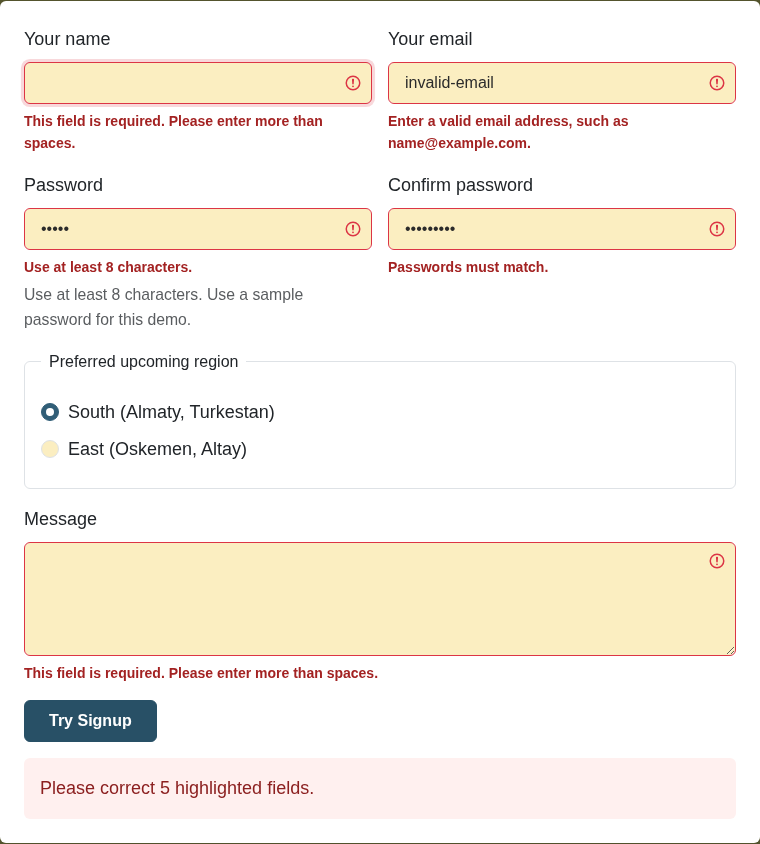
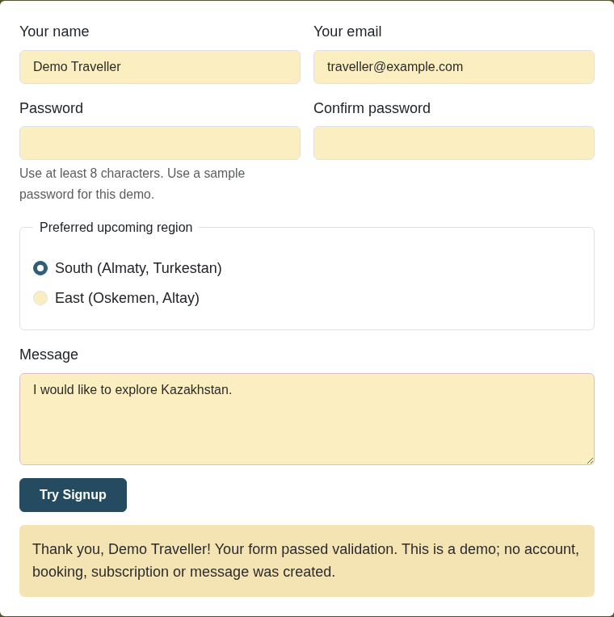
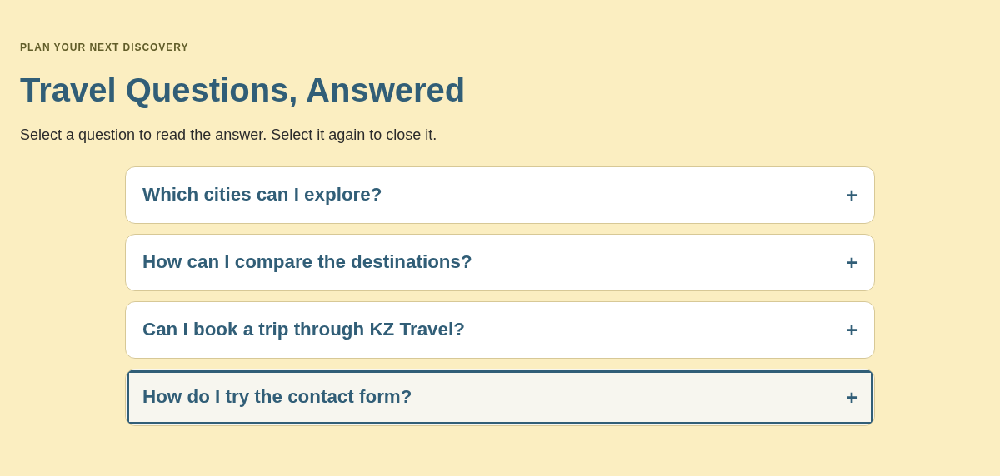
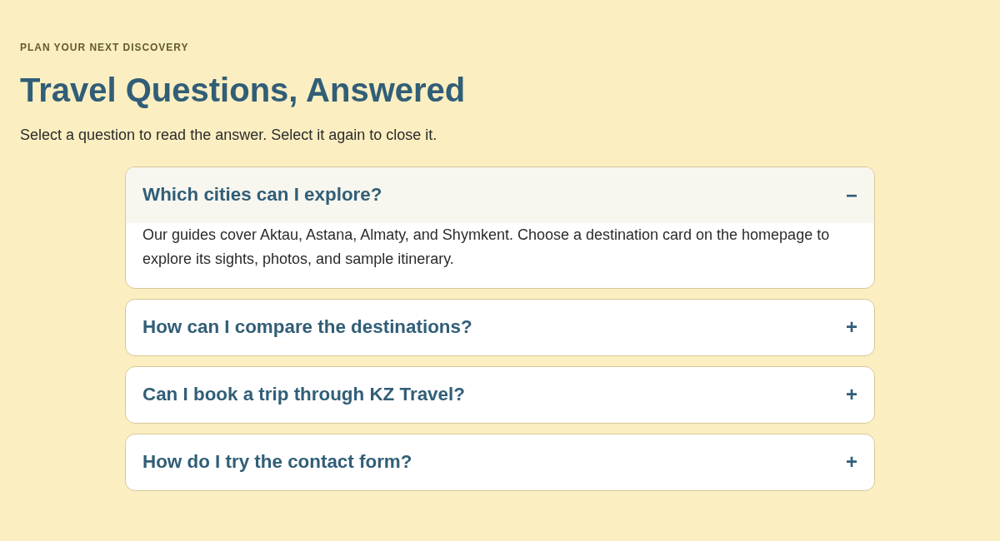
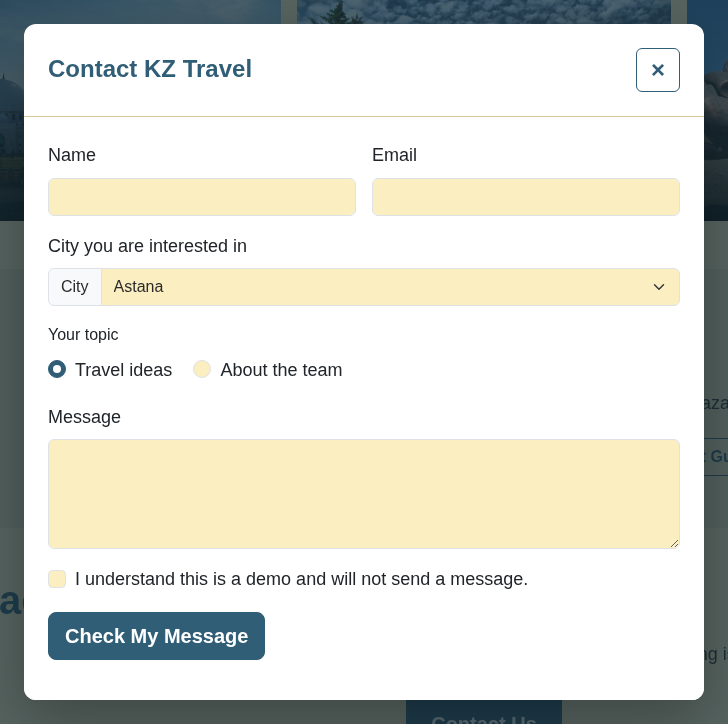
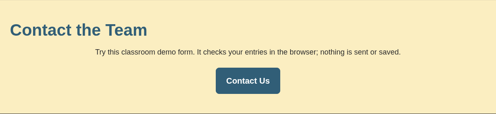
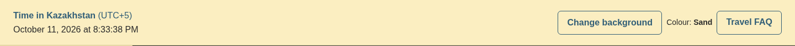
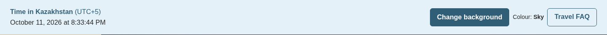
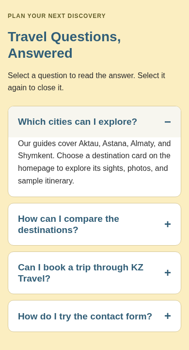
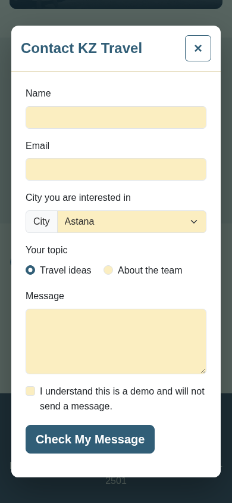

# Assignment 4: Introduction to JavaScript

Team: **KZ Travel**. Group: **SE-2501**. Prepared: **11 October 2026**.

Members: Ramazan Utegen, Ziyadinkhan Kudaibergenuly, and Ruzimuhammad.

Website: <https://ramazanutegen.github.io/assignment1web/>

## Objective and project scope

Continue the existing six-page travel project and use JavaScript to make its forms and content interactive. Keep the Bootstrap layouts, city guides, and previous assignments' features. Add all five requested components, then commit, push, redeploy, and prepare one report and ZIP for all three members.

## Three-person responsibility split

| Member | Responsibility | Files to study |
| --- | --- | --- |
| Ramazan Utegen | Task 1: required fields, email, password length, and matching confirmation | `js/forms.js`, the `#community` form in `index.html` |
| Ziyadinkhan Kudaibergenuly | Task 2: FAQ accordion with smooth opening and closing | `js/accordion.js`, the `#faq` section in `index.html`, FAQ rules in `css/assignment4.css` |
| Ruzimuhammad | Task 3: popup; Task 4: background colours; Task 5: date/time | `js/popup.js`, `js/preferences.js`, `js/clock.js`, `#contact` in `about.html` |

This is a responsibility and study split for the shared implementation. Each member must personally review and understand the code, practise modifying their component, and explain their teammates' components during the defence.

## Task 1: Form validation

1. Extend the homepage community form with Password and Confirm password fields. Set a documented minimum of eight characters; the assignment asks for a length rule but does not specify a number.
2. Link `js/forms.js` with `defer`, so it runs after HTML parsing. Find every form using `data-demo-form` and attach a submit listener.
3. Use `event.preventDefault()` to keep this static demo on the page. Once the JavaScript handler is ready, enable the submit button and use custom inline validation messages.
4. Reject missing or whitespace-only required values. Check email formatting, password length, and equality with confirmation. The contact checkbox must also be checked.
5. Display errors beside the relevant inputs, set `aria-invalid`, connect messages with `aria-describedby`, show an error summary, and focus the first invalid field.
6. Recheck fields as the user corrects them. If the original password changes, recheck confirmation too. For valid input, show a demo confirmation and clear password values.
7. Apply the shared handler to existing forms in Aktau, Almaty, Shymkent, and About Us as well as the homepage.

These forms perform client-side validation only. They do not create accounts, bookings, subscriptions, or messages, and do not store or transmit passwords.

## Task 2: FAQ accordion

1. Add four travel-guide questions to the homepage, using real buttons for the question titles.
2. Start every answer closed. Match each question's `aria-controls` to its answer's ID and set `aria-expanded="false"`.
3. On click, toggle the expanded state and the `.is-open` class. Update `aria-hidden` and `inert` for the answer panel.
4. Animate the answer's grid row from `0fr` to `1fr` over 0.3 seconds. Respect the visitor's reduced-motion preference.
5. Verify that repeated clicks and keyboard Enter both open and close each answer. Questions operate independently.

## Task 3: Popup contact form

1. Place the existing About Us contact form inside a labelled HTML `dialog`. It starts closed.
2. Use a Contact Us button and `showModal()` to open it above a dark backdrop.
3. Close with the labelled close button, Escape, or a click outside the dialog. Check pointer-down and click positions so a drag from inside does not accidentally dismiss it.
4. Keep keyboard focus inside the dialog with Tab/Shift+Tab handling. Return focus to Contact Us after closing. Stop the page behind it from scrolling while it is open.
5. Limit dialog width and height to the viewport so its form remains usable on phones. Validate its name, email, message, and acknowledgement with the shared handler.

## Task 4: Background colour button

1. Add a Change background button and current-colour label to a shared travel toolbar on every page.
2. Store Sand, Sky, and Steppe colours in an array.
3. On click, increment the index and use the remainder operator to wrap back to the first colour.
4. Assign the new colour to `document.body.style.backgroundColor` and update the displayed colour name.
5. Use a short CSS transition, with a reduced-motion override. Keep all colours light enough for the existing text to remain readable.

## Task 5: Current date and time

1. Add a `time` element with `data-live-clock` to the toolbar on every page.
2. Create a JavaScript `Date` object and set the time element's machine-readable `datetime` attribute.
3. Format it with `Intl.DateTimeFormat` for English month/day/year and readable time including seconds.
4. Use `Asia/Almaty` and display UTC+5 explicitly, so visitors see Kazakhstan time even when their computer is configured for another zone.
5. Call the update function immediately and every 1,000 milliseconds with `setInterval`.

## Deployment and packaging

1. Run the local server with `python3 -m http.server 8000` and test all six pages.
2. Generate the PDF report with `scripts/build-assignment4-report.py` and check its rendered pages.
3. Commit and push the changes to the existing shared repository, `ramazanutegen/assignment1web`, on `main`.
4. GitHub Pages is configured to deploy the root of `main`. Verify the Pages build and the new scripts on the live URL.
5. Create the ZIP with `scripts/package-assignment4.py`. It contains the six HTML pages, all CSS/JS/images, README, study notes, screenshots, scripts, and the PDF report.

## Verification and defence

The browser integration check exercises all six pages in Chromium and Firefox at desktop (1440 x 1100) and phone (390 x 844) sizes. It checks required/whitespace-only values, bad email, short and mismatched passwords, successful submission, accordion click and keyboard toggling, all popup close methods, focus handling, background cycling, live clock updates, timezone correctness, footer credits, viewport overflow, and JavaScript/HTTP asset errors.

Each member should be able to explain:

- How `querySelectorAll`, event listeners, and `preventDefault` connect HTML to JavaScript.
- How field values are validated and how confirmation is rechecked after editing a password.
- How the accordion keeps CSS and accessibility states in sync.
- Why a dialog starts hidden and how its open/close and focus behaviour works.
- Why `(index + 1) % colours.length` cycles through the backgrounds.
- How `new Date()`, a formatter, and `setInterval` produce the live clock.

Practice changes: Ramazan changes the minimum password length and its hint; Ziyadinkhan adds another FAQ with unique IDs; Ruzimuhammad adds a fourth background colour and changes the clock format. All members then explain another member's component.

## Final reflection and submission checklist

JavaScript now adds immediate input feedback, expandable content, a modal contact form, background control, and a live clock to the existing travel guide. The same shared files run across pages without replacing the previous responsive design. The exercise connects DOM selection, events, conditionals, arrays, CSS class changes, and timers to visible user interactions.

The next learning step is for each team member to rehearse their component and the shared behaviour. A production version would need server-side processing before its forms could create accounts or send messages.

- Each of the three members submits the same PDF report and project ZIP individually.
- The report includes every task's steps and screenshots, all three names, group, objective, live URL, and reflection.
- All six page footers contain the three team members' names.
- Check the deadline in the LMS; the PDF does not specify an exact date.
- Attend the practice lesson and defend the work. Defence accounts for 40% of the grade.
